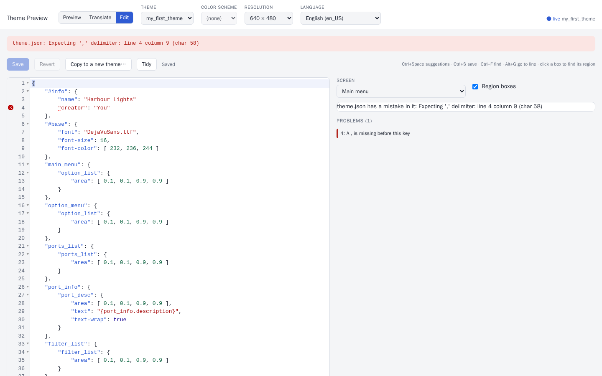
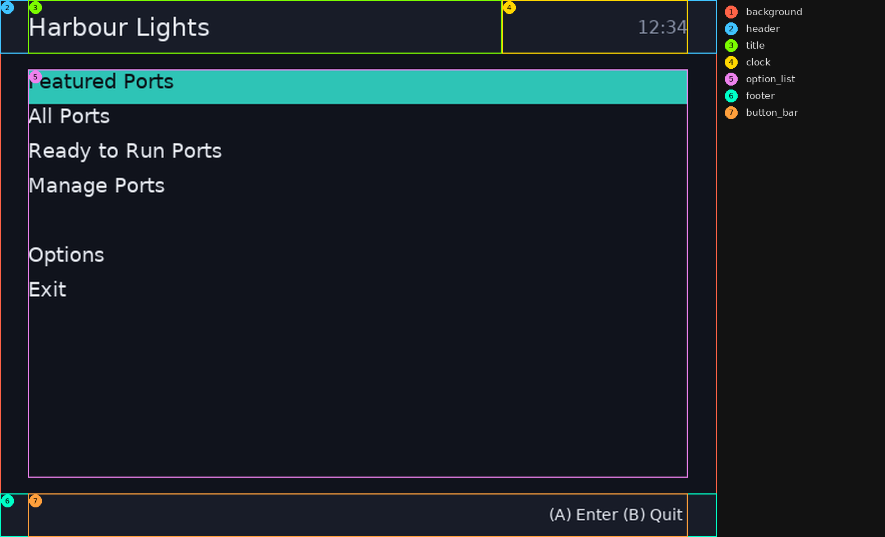
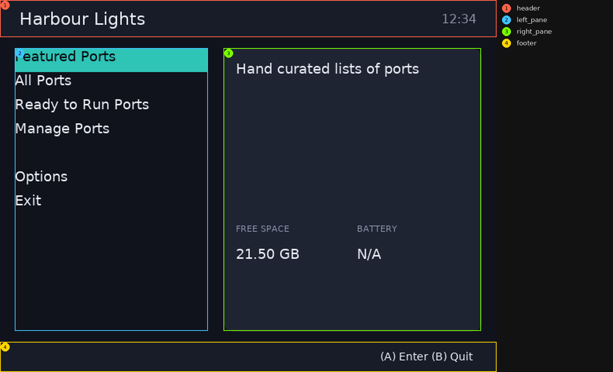
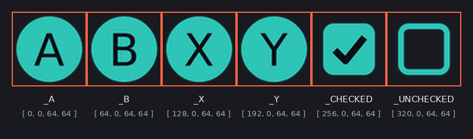
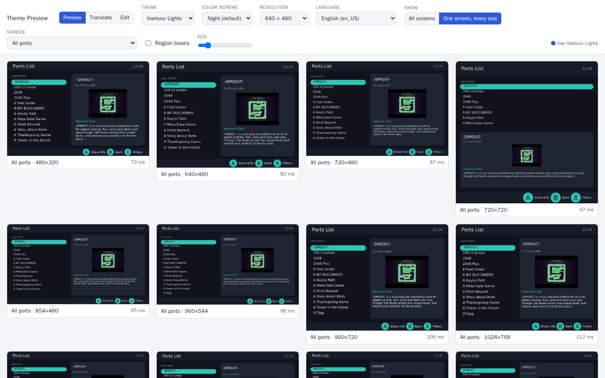

# Creating a PortMaster theme

This guide builds a theme from an empty folder to one in PortMaster's theme list: **Harbour Lights**, deep blue with a teal light, a day and a night color scheme, its own button pictures, and a layout that fits any screen. It explains each thing as it comes up, so by the end you'll know how a theme works, not only how this one does.


You don't need to know how to program. A theme is one text file, `theme.json`, plus any pictures and fonts you want to use. You'll write that file a piece at a time, and see every change on PortMaster's screens as you go.

Every step is a complete, working theme in [`docs/tutorial/`](docs/tutorial/): `step-1` is the theme at the end of step 1, and so on. If you get lost, or something won't work, open that step's `theme.json` and compare it with yours, or start the next step from it.

The full list of everything a theme can do is the [theme reference, THEME.md](https://github.com/PortsMaster/PortMaster-GUI/blob/main/THEME.md). You won't need it to follow this guide, but each step links to the part of it that says more.

## Contents

1. [What you need](#what-you-need)
2. [A quick look at theme.json](#a-quick-look-at-themejson)
3. [Step 1: the seven screens](#step-1-the-seven-screens)
4. [Step 2: colors, a header and a footer](#step-2-colors-a-header-and-a-footer)
5. [Step 3: two panes](#step-3-two-panes)
6. [Step 4: styles, and the other screens](#step-4-styles-and-the-other-screens)
7. [Step 5: a day and a night](#step-5-a-day-and-a-night)
8. [Step 6: pictures](#step-6-pictures)
9. [Step 7: every screen size, every language](#step-7-every-screen-size-every-language)
10. [Step 8: finishing touches](#step-8-finishing-touches)
11. [Trying it on your device](#trying-it-on-your-device)
12. [Sharing it](#sharing-it)
13. [Going further](#going-further)
14. [When something's wrong](#when-somethings-wrong)
15. [Cheat sheet](#cheat-sheet)
16. [The themes so far](#the-themes-so-far)

## What you need

### A way to see your theme

PortMaster's **theme server** draws every PortMaster screen with your theme: the main menu, the ports list, a port's details, the options, downloads, every one. It redraws them whenever you save, so you see each change straight away, and it has an editor built in. You can run it two ways.

**On your device, with nothing to install.** In PortMaster, open **Options › Theme Editor**. The screen shows an address, like `http://192.168.1.20:53104`, and a QR code of it. Open that address in a browser on a computer, tablet or phone on the same Wi-Fi network as the device. It shows the themes installed on the device, with the device's own list of ports. Press B on the device to stop it.

**On a computer** (Linux or macOS), from a copy of PortMaster's code. This needs Git and Python 3:

```bash
git clone https://github.com/PortsMaster/PortMaster-GUI
cd PortMaster-GUI
python3 -m venv .venv && .venv/bin/pip install -r requirements-dev.txt
.venv/bin/python tools/theme_server/serve.py --themes ~/my-themes
```

Then open http://localhost:8090/. `~/my-themes` is a folder you keep your themes in, one folder each. The first start downloads PortMaster's list of ports and their screenshots, so the screens look real.


At the top you choose the theme, its color scheme, the screen size and the language. **Region boxes** outlines everything on the screens and names it, which you'll use a lot. Click a screen to see it bigger.

### Somewhere to write theme.json

The theme server has an editor: pick **Edit** at the top. It shows `theme.json` on the left and one screen on the right, and the screen redraws a moment after you stop typing, before you've even saved. It suggests what you can type next (press Ctrl+Space), and it underlines mistakes and says what's wrong. Ctrl+S (⌘+S on a Mac) saves.


Any text editor is fine too: the theme server redraws when you save the file.

### A folder for the theme

A theme is a folder, and its name is how PortMaster knows it: lower case letters, digits and `_`, no spaces. This guide's is `harbour_lights`.

- **On a computer:** make the folder in your themes folder (`~/my-themes/harbour_lights/`), and an empty `theme.json` in it.
- **On a device:** the editor can't make an empty theme, but it can copy one. In **Edit**, pick any theme, then **Copy to a new theme…** and call it `harbour_lights`. Then select everything in the editor (Ctrl+A) and replace it with step 1's text below. The copy also has the other theme's pictures in its folder; that's harmless while you work, and you can tidy them away before you share it.

## A quick look at theme.json

`theme.json` is written in JSON, a common way of writing settings down. There are only a few rules, and the editor tells you when you break one.

```json
{
    "#info": {
        "name": "Harbour Lights",
        "creator": "You"
    },
    "main_menu": {
        "option_list": {
            "area": [ 0.1, 0.1, 0.9, 0.9 ],
            "font-size": 18,
            "text-wrap": true
        }
    }
}
```

- **Curly brackets `{ }`** hold named things: `"name": value` pairs, with a comma between each pair. Here the whole file is one, `"#info"` is one inside it, and so is `"main_menu"`.
- **Names and text go in double quotes**: `"name"`, `"Harbour Lights"`. Not single quotes.
- **Numbers don't**: `18`, `0.9`. A decimal point matters in a theme: `1.0` and `1` mean different things (you'll see why in step 1).
- **Square brackets `[ ]`** hold a list: `[ 0.1, 0.1, 0.9, 0.9 ]`.
- **`true` and `false`** are written plain, without quotes.

The four mistakes everyone makes:

| Mistake | Wrong | Right |
|---|---|---|
| A missing comma between two pairs | `"name": "Harbour Lights"` ⏎ `"creator": "You"` | `"name": "Harbour Lights",` ⏎ `"creator": "You"` |
| A comma after the last pair | `"creator": "You",` ⏎ `}` | `"creator": "You"` ⏎ `}` |
| Single quotes | `'name': 'Harbour Lights'` | `"name": "Harbour Lights"` |
| A comment | `// the menu` | JSON has none: a region can have a `"comment": "the menu"` key, which PortMaster ignores |

The editor marks the line and says what's wrong, in plain words:



**What the names mean.** Every name at the top of the file is either a **section**, which is one of PortMaster's screens (`main_menu`, `ports_list` …), or a **setting** starting with `#` (`#info`, `#base` …). Inside a section are its **regions**: rectangles PortMaster draws, each with a name you choose or that PortMaster asks for. Inside a region are its **keys**: where it goes, its color, its text and so on. Names are case-sensitive: `Font-Size` isn't `font-size`.

## Step 1: the seven screens

**In this step:** the smallest theme PortMaster will use, what a region is, and where one goes.

A theme has to draw seven of PortMaster's screens. Put this in `harbour_lights/theme.json` ([`docs/tutorial/step-1`](docs/tutorial/step-1/theme.json)):

```json
{
    "#info": {
        "name": "Harbour Lights",
        "creator": "You"
    },
    "#base": {
        "font": "DejaVuSans.ttf",
        "font-size": 16,
        "font-color": [ 232, 236, 244 ]
    },
    "main_menu":      { "option_list": { "area": [ 0.1, 0.1, 0.9, 0.9 ] } },
    "option_menu":    { "option_list": { "area": [ 0.1, 0.1, 0.9, 0.9 ] } },
    "ports_list":     { "ports_list":  { "area": [ 0.1, 0.1, 0.9, 0.9 ] } },
    "port_info":      { "port_desc":   { "area": [ 0.1, 0.1, 0.9, 0.9 ], "text": "{port_info.description}", "text-wrap": true } },
    "filter_list":    { "filter_list": { "area": [ 0.1, 0.1, 0.9, 0.9 ] } },
    "message_window": { "message_text": { "area": [ 0.1, 0.1, 0.9, 0.9 ], "text": "" } },
    "message_box":    { "message_text": { "area": [ 0.1, 0.1, 0.9, 0.9 ], "text": "", "text-wrap": true } }
}
```


It's plain, but it's a theme: PortMaster could use it. Here's what's in it.

**`#info`** names the theme and says who made it. Both are needed to share it; it can also have a `description` (shown in the theme list) and a `version`.

**`#base`** holds keys that every region in the theme starts from, so they don't have to be written in each one: the font, its size, its color. `DejaVuSans.ttf` comes with PortMaster, so the theme doesn't need a copy of it. `[ 232, 236, 244 ]` is a color: red, green and blue, each from 0 to 255, so this is nearly white.

**The seven sections** are the screens every theme needs:

| Section | The screen | The region it needs |
|---|---|---|
| `main_menu` | the first screen | `option_list`: the menu |
| `option_menu` | Options, and every list of choices it opens | `option_list` |
| `ports_list` | All Ports, Ready to Run, Manage Ports | `ports_list` |
| `port_info` | one port's details, where it's installed | none |
| `filter_list` | the filters and sorting | `filter_list` |
| `message_window` | downloads and installs, as they happen | `message_text` |
| `message_box` | a question or a warning | `message_text` |

PortMaster finds the list on each screen by its region's name, and fills it in itself: you don't write the menu's items or the ports. Leave one of these out and PortMaster can't open that screen. The other screens (the theme list, featured ports, a port's links …) are made from these when a theme doesn't have them; [the screens](https://github.com/PortsMaster/PortMaster-GUI/blob/main/THEME.md#the-screens) lists them all.

**`area`** is where a region goes: `[ left, top, right, bottom ]`, the positions of its edges. A number with a decimal point between `0.0` and `1.0` is a fraction of the screen: `0.1` is a tenth of the way across (for left and right) or down (for top and bottom). So `[ 0.1, 0.1, 0.9, 0.9 ]` is the middle of the screen, with a tenth left empty all round. A whole number is pixels, which is why `1.0` (the whole width) and `1` (one pixel) aren't the same.

**`{port_info.description}`** is a **tag**: PortMaster puts the selected port's description there, and changes it when another port is selected. Tags are how text on the screens changes; you'll use more in step 3.

**What to look at.** In the theme server, look at the filters screen: the filters are drawn straight over the ports list, and say `_UNCHECKED` where the checkboxes should be. The filters screen is drawn on top of the ports list, with nothing behind it yet, and `_UNCHECKED` is a special word that wants a picture or some text. Both get fixed below.

**Try it yourself.** Change `font-size` in `#base` to `24` and watch every screen change. Change the main menu's area to `[ 0.5, 0.1, 0.95, 0.9 ]` and it moves to the right half of the screen.

## Step 2: colors, a header and a footer

**In this step:** naming colors, regions that every screen shares, and putting one region inside another. ([`docs/tutorial/step-2`](docs/tutorial/step-2/theme.json))

### Colors with names

Writing `[ 232, 236, 244 ]` everywhere gets old, and changing it later means finding every one. Instead, name the theme's colors once in **`#pallet`**, and use the names:

```json
    "#pallet": {
        "background": "#10131c",
        "panel":      "#181c28",
        "card":       "#1f2433",
        "text":       "#e8ecf4",
        "text_dim":   "#8a93a8",
        "accent":     "#2ec4b6",
        "on_accent":  "#0b0e15"
    },
    "#base": {
        "font": "DejaVuSans.ttf",
        "font-size": 16,
        "font-color": "text"
    },
```

`"#10131c"` is the same kind of color as before, written the way web pages write them: `#`, then red, green and blue, each as two digits from `00` to `ff`. Any color picker gives you this.

Name colors by what they're for, not what they look like: `accent` rather than `teal`. In step 5 the theme gets a second set of colors where the accent isn't teal at all, and every region using `accent` changes with it.

### Shared regions: elements

Every screen should have the same background, a header with its title and the time, and a footer with the buttons. Rather than writing those regions out seven times, define them once in **`#elements`**:

```json
    "#elements": {
        "background": { "area": [ 0.0, 0.0, 1.0, 1.0 ], "fill": "background" },
        "header":     { "area": [ 0.0, 0.0, 1.0, 0.1 ], "fill": "panel" },
        "title":      { "parent": "header", "area": [ 0.04, 0.0, 0.7, 1.0 ], "font-size": 22,
                        "align": "midleft", "text": "{scene.title}" },
        "clock":      { "parent": "header", "area": [ 0.7, 0.0, 0.96, 1.0 ], "font-color": "text_dim",
                        "align": "midright", "text": "{system.time_24hr}" },
        "footer":     { "area": [ 0.0, 0.92, 1.0, 1.0 ], "fill": "panel" },
        "button_bar": { "parent": "footer", "area": [ 0.04, 0.0, 0.96, 1.0 ], "font-size": 14,
                        "align": "midright", "bar": [] }
    },
```

New keys in there:

- **`fill`** is the region's background color.
- **`parent`** puts a region inside another one: `title`'s area is a part of `header`, not of the whole screen. `[ 0.04, 0.0, 0.7, 1.0 ]` is the header's full height, from 4% to 70% across it. Move or resize the header, and its title and clock move with it.
- **`align`** is where the text sits in its region: `midleft` is the middle of the left edge. The others are `topleft`, `midtop`, `topright`, `center`, `midright`, `bottomleft`, `midbottom` and `bottomright`.
- **`{scene.title}`** is each screen's title ("Ports List", "Options Menu"), **`{system.time_24hr}`** the time.
- **`button_bar`** is a region name PortMaster looks for, on every screen: it fills its `bar` with the buttons that screen offers ("A Enter", "B Quit").

### Using them on the screens

A screen uses an element with `"#element:<name>"`. Its `{ }` can change any of the element's keys for this screen only, or be left empty:

```json
    "main_menu": {
        "#element:background": {},
        "#element:header": {},
        "#element:title": { "text": "Harbour Lights" },
        "#element:clock": {},
        "option_list": {
            "area": [ 0.04, 0.13, 0.96, 0.89 ],
            "font-size": 18,
            "line-height": 1.5,
            "select-fill": "accent",
            "select-color": "on_accent"
        },
        "#element:footer": {},
        "#element:button_bar": {}
    },
```

- **Regions are drawn in the order they're written.** The background comes first so everything else is drawn on top of it.
- The main menu's title is the theme's name instead of the screen's: `"#element:title": { "text": "Harbour Lights" }`.
- **`select-fill`** and **`select-color`** are the selected row's background and text color. **`line-height`** spaces the rows out: 1.5 times the font's own line height.

The other six screens use the same elements, each with its own list. Here's the main menu with the theme server's **Region boxes** on, which shows where every region is:



### The special words

The buttons in the bar and the checkboxes in the filters are **special words**: `_A`, `_B`, `_X`, `_Y`, `_CHECKED`, `_UNCHECKED` and a few more. A theme shows them as pictures (step 6) or as text, set in `#override`:

```json
    "#override": { "_A": "(A)", "_B": "(B)", "_X": "(X)", "_Y": "(Y)", "_CHECKED": "[x]", "_UNCHECKED": "[ ]" },
```


**Try it yourself.** Change `accent` in `#pallet` to `"#e9a03b"`, and every selected row turns amber. Change the header's area to `[ 0.0, 0.0, 1.0, 0.14 ]` and watch the title and clock follow it.

## Step 3: two panes

**In this step:** splitting the screen into panes, the three kinds of number an area can have, and showing a port's details. ([`docs/tutorial/step-3`](docs/tutorial/step-3/theme.json))

### Panes

Split the space between the header and footer into two **panes**: a list on the left, a card on the right. They're two more elements, and from now on everything on a screen sits inside one of them:

```json
        "left_pane":  { "area": [ 0.03, 0.13, 0.42, 0.89 ] },
        "right_pane": { "area": [ 0.45, 0.13, 0.97, 0.89 ], "fill": "card", "roundness": 12 },
```



This is the most useful habit in theme making. Each region's area is a part of its pane, not of the screen, so to change the layout you only move the panes: the regions inside them follow. In step 7 that's how the theme fits square screens, with two lines.

`left_pane` has no `fill`: it's only there to be a parent, and isn't drawn. **`roundness`** rounds the card's corners, by 12 pixels.

### One look for every list

Every screen's list should look the same, so make that an element too:

```json
        "menu": {
            "parent": "left_pane",
            "area": [ 0.0, 0.0, 1.0, 1.0 ],
            "font-size": 18,
            "line-height": 1.5,
            "select-fill": "accent",
            "select-color": "on_accent",
            "autoscroll": "marquee"
        },
```

`"#element:menu:option_list"` draws the `menu` element as a region called `option_list`: the part after the second `:` is the region's name. So the main menu has `"#element:menu:option_list": {}`, the ports list `"#element:menu:ports_list": { … }`, and so on. **`autoscroll`** scrolls a row's text sideways when it's too long to fit (`marquee` goes there and back).

### The ports list

The ports list shows the selected port in the card, with tags:

```json
    "ports_list": {
        …
        "port_count": { "parent": "left_pane", "area": [ 0.0, 0.0, 1.0, 0.08 ], "font-size": 11,
                        "font-color": "text_dim", "text": "{ports_list.filter_ports} PORTS" },
        "#element:menu:ports_list": { "area": [ 0.0, 0.09, 1.0, 1.0 ], "font-size": 15 },
        "#element:right_pane": {},
        "port_title":  { "parent": "right_pane", "area": [ 16, 12, -16, 0.13 ], "font-size": 18, "text": "{port_info.title}" },
        "port_porter": { "parent": "right_pane", "area": [ 16, 0.13, -16, 0.2 ], "font-size": 12, "text": "by {port_info.porter}" },
        "port_image":  { "parent": "right_pane", "area": [ 16, 0.22, -16, 0.62 ], "image": "{port_info.image}" },
        "port_status": { "parent": "right_pane", "area": [ 16, 0.63, -16, 0.7 ], "font-color": "accent", "text": "{port_info.ready_to_run}" },
        "port_desc":   { "parent": "right_pane", "area": [ 16, 0.71, -16, -12 ], "font-size": 12, "text-wrap": true,
                         "text": "{port_info.description}" },
        …
    },
```


### Fractions, pixels and negative numbers

The card's areas mix three kinds of number:

| In an area | Means | Example |
|---|---|---|
| `0.0` to `1.0`, with a point | a fraction of the parent | `0.22`: 22% of the way down the card |
| a whole number, for left or top | that many pixels in from the parent's left or top edge | `16`: 16 pixels in from the left |
| a negative number | that many pixels in from the parent's right or bottom edge | `-16`: 16 pixels in from the right |

So `[ 16, 0.22, -16, 0.62 ]` is the card's width less 16 pixels each side, from 22% to 62% of the way down. Use pixels only for small gaps like these, and fractions for everything else: pixels stay the same size on a bigger screen, fractions grow with it. (A whole number for right or bottom is a position on the screen, not in the parent: use a fraction or a negative number there.)

### Tags for a port

These are the selected port's tags, on the ports list and the port info screen:

| Tag | |
|---|---|
| `{port_info.title}` | its name |
| `{port_info.porter}` | who ported it |
| `{port_info.image}` | its screenshot, for an `image` |
| `{port_info.description}`, `{port_info.instructions}` | what it is, and how to set it up |
| `{port_info.genres}` | its genres |
| `{port_info.ready_to_run}` | "Ready to Run", or "Requires Files" if you have to copy the game's files over |
| `{port_info.download_size}`, `{port_info.install_size}` | sizes |
| `{port_info.runtime}` | the runtime it needs, if any |

[Tags](https://github.com/PortsMaster/PortMaster-GUI/blob/main/THEME.md#tags) has every one, for every screen. `"image": "{port_info.image}"` shows the screenshot, as big as fits in its area without stretching it.

In the theme server, **Region boxes** shows how the ports list is put together:


**Try it yourself.** Swap the panes round: give `left_pane` the area `[ 0.58, 0.13, 0.97, 0.89 ]` and `right_pane` `[ 0.03, 0.13, 0.55, 0.89 ]`. Everything goes with them, on every screen.

## Step 4: styles, and the other screens

**In this step:** naming a look so you can reuse it, how a region gets its keys, and finishing the screens. ([`docs/tutorial/step-4`](docs/tutorial/step-4/theme.json))

### Styles

Small grey labels, big headings, wrapped body text: the same few looks come up on every screen. Name them in **`#styles`**, and give a region a `style` to start from:

```json
    "#styles": {
        "heading": { "font-size": 22 },
        "label":   { "font-size": 11, "font-color": "text_dim" },
        "body":    { "font-size": 14, "text-wrap": true, "autoscroll": "slide", "scroll-delay-start": 3000 }
    },
```

```json
        "genre_label": { "parent": "left_pane", "area": [ 0.0, 0.64, 1.0, 0.71 ], "style": "label", "text": "GENRE" },
        "genre":       { "parent": "left_pane", "area": [ 0.0, 0.71, 1.0, 0.8 ], "text": "{port_info.genres}" },
```

Change `label` once, and every label on every screen changes.

### Where a region's keys come from

A region's keys are put together from these, each one over the one before:

1. the theme's `#base`
2. the element it's made from (`"#element:menu:ports_list"` starts from `menu`), and that element's style
3. its own style
4. its own keys

So a region's own keys always win: `"style": "label", "font-size": 12` is a slightly bigger label. If something doesn't look the way you expect, the theme server tells you where its keys came from: in a screen's big view, click a region's box to see its final keys.

### The other screens

Now the rest of the seven screens get the same header, footer and panes:

- **Port info** shows the screenshot and details on the left, and the description and instructions in the card.
- **Downloads** (`message_window`) shows what's happening in a card, with a **progress bar**: a region PortMaster looks for, called `progress_bar`, which it fills with `progress-fill` as a download goes. `{system.progress_text}` and `{system.progress_amount}` say what and how much.
- **A question** (`message_box`) is a card in the middle, over a dimmed screen.
- **The filters** are drawn on top of the ports list, so the ports should show dimly behind them:

```json
    "filter_list": {
        "#element:background": { "fill": "fade", "blend-mode": "blend" },
        …
        "#element:right_pane": {},
        "#element:menu:filter_list": { "parent": "right_pane", "area": [ 12, 12, -12, -12 ], "font-size": 14, "line-height": 1.4 },
        …
    },
```

`fade` is the background color, but see-through: `[ 16, 19, 28, 200 ]`. A fourth number is how solid a color is, from 0 (invisible) to 255 (solid), and `"#rrggbbaa"` works too. A see-through color needs `"blend-mode": "blend"`, or it's drawn solid. The message box's dimmed background is the same.


**Try it yourself.** Give the `label` style `"font-color": "accent"`, and every label turns teal.

## Step 5: a day and a night

**In this step:** color schemes, which players pick from in Options. ([`docs/tutorial/step-5`](docs/tutorial/step-5/theme.json))

Because every color has a name, a second set of colors is just a second `#pallet`. Color schemes go in **`#schemes`**, and the player picks one in **Options › Select Color Scheme**:

```json
    "#info": { …, "default-scheme": "Night" },
    "#schemes": {
        "Night": {
            "#pallet": { "background": "#10131c", "panel": "#181c28", "card": "#1f2433", "text": "#e8ecf4",
                         "text_dim": "#8a93a8", "accent": "#2ec4b6", "on_accent": "#0b0e15", "fade": [ 16, 19, 28, 200 ] }
        },
        "Day": {
            "#pallet": { "background": "#efe9df", "panel": "#e2dacd", "card": "#fbf8f2", "text": "#22262e",
                         "text_dim": "#6b6f78", "accent": "#16857a", "on_accent": "#ffffff", "fade": [ 239, 233, 223, 200 ] }
        }
    },
```

- The theme's own `#pallet` goes: each scheme brings its own, and every scheme needs every name.
- **`default-scheme`** in `#info` is the one a player gets first.
- A scheme can change `#resources` and `#base` too (step 6 uses that), not only colors.


**Choosing colors.** Small handheld screens, often seen in sunlight, need more contrast than a monitor: light text on a dark background, or dark on light, never mid-grey on grey. The selected row is the thing a player looks for most, so make `accent` stand out from everything else, and check `on_accent` (the selected row's text) is easy to read on it. Day's accent is a darker teal than Night's, because the light teal would be hard to read on a pale card. In the theme server, flick between the schemes at the top and look at every screen in each one.

**Try it yourself.** Add a third scheme, `"Dusk"`, copying Night's colors with a purple `accent`.

## Step 6: pictures

**In this step:** using pictures, cutting one picture into several, and tinting a picture per scheme. ([`docs/tutorial/step-6`](docs/tutorial/step-6/), with its `buttons.png` and `pointer.png`)

### Where pictures go

Pictures go in the theme folder, next to `theme.json` (or in a folder of their own: `"images/panel.png"`). PNG is best, as it can be see-through; JPEG suits big photos; SVG works too. Names are case-sensitive on the devices: `Buttons.PNG` isn't `buttons.png`.

Any region can show one with `"image"`. Pictures the theme uses everywhere go in **`#resources`**, which loads them once, with the theme.

### One picture, many pieces: an atlas

The buttons and checkboxes are six small pictures. Drawing them on one picture, `buttons.png`, in a row of 64x64 squares, keeps them together. **`atlas`** cuts it into pieces, each `[ x, y, width, height ]` in pixels from the picture's top left, and gives each piece a name:



```json
    "#resources": {
        "buttons.png": {
            "atlas": {
                "_A": [ 0, 0, 64, 64 ],   "_B": [ 64, 0, 64, 64 ],
                "_X": [ 128, 0, 64, 64 ], "_Y": [ 192, 0, 64, 64 ],
                "_CHECKED": [ 256, 0, 64, 64 ], "_UNCHECKED": [ 320, 0, 64, 64 ]
            }
        }
    }
```

The pieces are named as the special words they stand for, so PortMaster uses them for those words, and the `#override` text isn't needed any more: take it out. Draw such pictures bigger than they'll be shown (64x64 for buttons shown at about 20 pixels), so they stay sharp on big screens.

### The pill: a pointer, tinted per scheme

The selected row gets rounded ends, like a pill: a **pointer**, a picture PortMaster draws beside the selected row. `pointer.png` is one white half circle. White, because each scheme can tint it its own accent color with **`image-mod`**, which multiplies every pixel by a color (white times teal is teal).

A scheme can change `#resources`, but a scheme's `#resources` takes the place of the theme's, so the theme's own `#resources` moves into the schemes. `#schemes` can have a `#base` of its own, which every scheme starts from: the buttons go there, and each scheme adds its tinted pointer:

```json
    "#schemes": {
        "#base": { "#resources": { "buttons.png": { "atlas": { … } } } },
        "Night": { "#pallet": { … }, "#resources": { "pointer.png": { "image-mod": [ 46, 196, 182 ] } } },
        "Day":   { "#pallet": { … }, "#resources": { "pointer.png": { "image-mod": [ 22, 133, 122 ] } } }
    },
```

(`image-mod` here takes `[ red, green, blue ]` numbers, not a `#pallet` name.) Then the list element gets the pointer:

```json
        "menu": {
            …
            "pointer": "pointer.png",
            "pointer-fit": "row",
            "pointer-attach": "list",
            "pointer-align": [ "midleft", "midright" ],
            "pointer-mirror": true
        },
```

- **`pointer-fit: row`** makes the pointer exactly as tall as a row, whatever the font size, keeping its shape.
- **`pointer-attach: list`** puts it at the ends of the row, rather than next to the text.
- **`pointer-align`** says which point of the row it's attached to (`midleft`), and which point of the pointer goes there (`midright`).
- **`pointer-mirror`** adds a flipped copy at the other end.


**Try it yourself.** Draw your own pointer: a triangle instead of a half circle, white, 32x64 pixels, saved over `pointer.png`. Or put a background picture on the main menu: `"#element:background": { "image": "my_background.png", "image-mode": "stretch" }`.

## Step 7: every screen size, every language

**In this step:** making the theme fit every handheld, and every language PortMaster speaks. ([`docs/tutorial/step-7`](docs/tutorial/step-7/): the finished theme)

### Text that follows the screen

PortMaster runs on handhelds with screens from 480x320 to 1920x1152: wide ones, square ones, small ones. So far the theme's sizes are right for 640x480. One line in `#base` makes text follow the screen:

```json
        "font-scale": "auto",
```

`"auto"` multiplies every font size by how much bigger the screen is than 640x480: 1.5 on a 1280x720 screen, about 2.3 on 1920x1080. It never goes below 0.75, so text on tiny screens stays readable. (A theme can give its own number for a screen too: `"font-scale[1280x720]": 1.4` after it.)

### Square screens: capabilities

Because every region sits in a pane, and the panes are fractions of the screen, the layout stretches to fit any shape. Except one: on a square screen the two panes side by side are too narrow.

A key with something in square brackets after its name, a **capability**, counts only on devices that have it. `[square]` is any screen that's square or nearly. So the panes stack on square screens:

```json
        "left_pane":  { "area": [ 0.03, 0.13, 0.42, 0.89 ], "area[square]": [ 0.03, 0.13, 0.97, 0.47 ] },
        "right_pane": { "area": [ 0.45, 0.13, 0.97, 0.89 ], "area[square]": [ 0.03, 0.5, 0.97, 0.89 ], … },
```

Only the panes change; everything in them follows. When a key is there more than once, the last one that matches the device wins, so the plain one comes first.

| Capability | Counts on |
|---|---|
| `[640x480]`, `[1280x720]` … | that screen size |
| `[4:3]`, `[16:9]`, `[3:2]`, `[1:1]` | that shape |
| `[wide]` | 3:2 or wider |
| `[square]` | square, or nearly |
| `[hires]`, `[lowres]` | big screens (960 wide or 720 tall, or more); small ones (under 640x480) |
| `[ja_JP]`, `[de_DE]` … | that language |

`,` means "and", `|` means "or" and `!` means "not": `"area[wide,hires]"`, `"font-size[ja_JP|ko_KR]"`, `"fill[!hires]"`. [Capabilities](https://github.com/PortsMaster/PortMaster-GUI/blob/main/THEME.md#capabilities-keys-for-some-devices) has the full list.


### Checking every size

In the theme server, **One screen, every size** shows one screen at every common screen size at once. Look at each screen this way: it's the quickest way to spot text that doesn't fit, or a pane that's too narrow.



From a PortMaster-GUI checkout, the theme server can also check every screen for you. This draws them all at the sizes you give, in every scheme and layout, and lists anything overlapping, cut off or off the screen:

```bash
.venv/bin/python tools/theme_server/serve.py --themes ~/my-themes --export /tmp/out \
    --theme harbour_lights --resolutions 480x320,640x480,720x720,1280x720,720x1280 --schemes all --layouts all --check
```

It ends with something like `260 screens: 0 with errors, 0 with warnings only`. Harbour Lights passes at all of these.

### Languages

PortMaster is translated into many languages. Two things to check:

- **Chinese, Japanese and Korean** need fonts of their own: DejaVu Sans has none of their letters. PortMaster carries Noto Sans for each, and `font-override` gives every region that font in that language:

  ```json
          "font-override[ja_JP]": "NotoSansJP-Regular.ttf",
          "font-override[ko_KR]": "NotoSansKR-Regular.ttf",
          "font-override[zh_CN]": "NotoSansSC-Regular.ttf",
          "font-override[zh_TW]": "NotoSansTC-Regular.ttf",
          "font-override[zh_HK]": "NotoSansHK-Regular.ttf"
  ```

- **German and others have long words.** "DOWNLOAD SIZE" is "DOWNLOADGRÖSSE". Leave room, or let text scroll with `autoscroll`.


Pick a language at the top of the theme server to see the screens in it. The text your theme writes itself ("FREE SPACE", "GENRE") is translated too, once the theme is in the theme list: see [translations](https://github.com/PortsMaster/PortMaster-GUI/blob/main/THEME.md#translations).

## Step 8: finishing touches

**In this step:** what a theme needs before it's shared.

- **A screenshot.** `screenshot.png` in the theme folder is the theme's picture in PortMaster's theme list. Save one from the theme server: click the main menu or the ports list for its big view, at 640x480, and **Save PNG**.
- **A description.** `#info`'s `description` is shown in the theme list, under the screenshot. Say what it looks like and what's special about it (its schemes, its layouts): "Deep blue with a teal light, rounded cards. Color schemes: Night and Day."
- **A version.** `#info`'s `version` is a number: start at `1`, and add one every time you change the theme after it's shared.
- **Credits.** If the theme carries fonts, or pictures you didn't make yourself, list them in a `CREDITS.md` with who made them and their license, and put each license's file in the folder too ([Sharing it](#sharing-it) says how). Harbour Lights uses only PortMaster's own fonts and its own pictures, so it needs none.
- **A tidy folder.** Take out anything the theme doesn't use: pictures left from the theme you copied, backups (`theme.json.bak`).

Then a last look, on a device if you can:

- [ ] every screen, in every scheme, in the theme server's **All screens**
- [ ] **One screen, every size**, for the main menu, the ports list and port info
- [ ] a language with long words (German) and one with its own font (Japanese)
- [ ] a port that needs files ("Requires Files") and one with a long description
- [ ] the filters, a download, and a question (installing a port asks one)

## Trying it on your device

1. Copy the theme folder into the `themes` folder inside your device's PortMaster folder. Where that is depends on the system: it's the `PortMaster` folder next to your ports, `roms/ports/PortMaster/themes/` on most.
2. In PortMaster, open **Options › Select Theme**, and pick it.

If you made it with the device's Theme Editor, it's there already: press B to stop the editor, then **Options › Select Theme**.

What to look for on a real screen: text that's hard to read from arm's length, colors that wash out in daylight, and the selected row: can you find it at a glance?

## Sharing it

Themes in PortMaster's theme list come from this repository, [PortMaster-Themes](https://github.com/PortsMaster/PortMaster-Themes). To add yours, you need a GitHub account.

1. **Fork this repository** (the Fork button at the top of its GitHub page): your own copy, which you can change.
2. **Add your theme folder** to `themes/` in your fork. Either clone it and copy the folder in, or on GitHub's site open `themes/`, **Add file › Upload files**, and drop the folder in.
3. **Credits and licenses.** Every font in the folder needs a license that lets PortMaster share it (free for non-commercial use is fine). List each in `CREDITS.md`, with the license file next to it:

   ```markdown
   | File | Font | Author | License |
   |---|---|---|---|
   | `Inter-Medium.otf` | Inter Medium | Rasmus Andersson | SIL Open Font License 1.1 ([LICENSE.inter.txt](LICENSE.inter.txt)) |
   ```

   Fonts from [Google Fonts](https://fonts.google.com) are almost all SIL Open Font License, and safe to use. Fonts PortMaster carries (DejaVu Sans, Noto Sans CJK) don't need a copy or a credit.
4. **Check it**, if you've cloned the repository: `python3 tools/build_themes.py --check-only` should say `all themes pass`, and the layout check from step 7 should find no errors.
5. **Open a pull request** from your fork. It runs the same checks, at several screen sizes, and someone from PortMaster has a look.

Once it's merged, it's in everyone's theme list. To change it later, do the same with your changes, and add one to its `version` so players are offered the update.

## Going further

Harbour Lights uses most of what a theme can do, but not all of it. When you're ready for more, these are in [THEME.md](https://github.com/PortsMaster/PortMaster-GUI/blob/main/THEME.md):

- **[A list or a grid](https://github.com/PortsMaster/PortMaster-GUI/blob/main/THEME.md#layouts-a-list-or-a-grid):** let players choose between the ports as a list and as a grid of screenshots, like the default theme does.
- **[9-patch pictures](https://github.com/PortsMaster/PortMaster-GUI/blob/main/THEME.md#images):** cards and panels drawn from a picture whose corners stay sharp at any size, for shadows, borders and textures `roundness` can't do.
- **[Sounds and music](https://github.com/PortsMaster/PortMaster-GUI/blob/main/THEME.md#sounds-and-music):** a click when the selection moves, music on the main menu.
- **[Text templates](https://github.com/PortsMaster/PortMaster-GUI/blob/main/THEME.md#text-templates):** text that shows only sometimes, like `{if:port_info.runtime}Needs {port_info.runtime}{endif}`.
- **[QR codes](https://github.com/PortsMaster/PortMaster-GUI/blob/main/THEME.md#images):** the port links screen shows a port's website and store pages as QR codes, `"image": "qr:{port_links.url}"`.
- **[Animations](https://github.com/PortsMaster/PortMaster-GUI/blob/main/THEME.md#animations):** pictures that change frame by frame.
- **[Your own buttons](https://github.com/PortsMaster/PortMaster-GUI/blob/main/THEME.md#the-button-bar-and-special-words):** give the shoulder buttons jobs on the port info screen.

Looking at how other themes do things is the quickest way to learn: their folders are all in [`themes/`](themes/), and the theme server shows any of them, with region boxes.

## When something's wrong

| What you see | Why, and what to do |
|---|---|
| The theme isn't in the list | `theme.json` has a mistake in it, or it's not in a folder of its own in `themes`. Open it in the theme server's editor: it points to the mistake. |
| PortMaster quits when you open a screen | One of the seven screens is missing, or a region it needs isn't there: the theme server says which, on that screen. |
| A picture doesn't show | Its name is spelled differently (capitals count), or it's not in the theme folder. The theme server lists the error under the screen. |
| A font doesn't work | The same: check its name, capitals and all, and that the file is in the folder. |
| `_A` or `_UNCHECKED` in the button bar or the filters | Those special words have neither a picture nor `#override` text. |
| Square boxes instead of letters in Chinese, Japanese or Korean | The font has none of their letters: add the `font-override` lines from step 7. |
| A see-through color is solid | It needs `"blend-mode": "blend"`. |
| Text is tiny on a big screen | `"font-scale": "auto"` in `#base`. |
| Text is cut off | Its area is too small for it: make the area bigger, or let it scroll with `"autoscroll": "slide"`. |
| Something's in the wrong place on one screen size | Give its pane a capability key for that size or shape (`"area[16:9]"`), rather than each region. |
| A key does nothing | Its name is wrong (the editor flags names it doesn't know, with "did you mean"), or it's on the wrong thing (a `select-fill` on a region that isn't a list). |
| Colors look wrong in one scheme | A color name that's in one scheme's `#pallet` but not in that one's. |
| It looks different on the device | The device's screen size or language: pick the same in the theme server to see it there. |
| Something else | PortMaster writes what went wrong to `pugwash.txt` in its folder: errors about the theme name the region and key. |

## Cheat sheet

The keys you'll use most. [Region keys](https://github.com/PortsMaster/PortMaster-GUI/blob/main/THEME.md#region-keys) has every one.

| Key | What it does | Example |
|---|---|---|
| `area` | where the region goes | `[ 0.1, 0.1, 0.9, 0.9 ]` |
| `parent` | the region or element it's inside | `"left_pane"` |
| `fill` | its background color | `"card"` |
| `roundness` | rounded corners, in pixels | `12` |
| `outline`, `thickness` | a border, and how thick | `"accent"`, `2` |
| `text` | its text, with tags | `"{port_info.title}"` |
| `font`, `font-size`, `font-color` | how the text looks | `"DejaVuSans.ttf"`, `16`, `"text"` |
| `align` | where the text sits | `"midleft"` |
| `text-wrap` | break long text into lines | `true` |
| `autoscroll` | scroll text that doesn't fit | `"slide"`, `"marquee"` |
| `image` | a picture | `"logo.png"`, `"{port_info.image}"` |
| `image-mode` | how a picture fits | `"fit"`, `"stretch"`, `"repeat"` |
| `select-fill`, `select-color` | a list's selected row | `"accent"`, `"on_accent"` |
| `line-height` | a list's row spacing | `1.5` |
| `pointer` | a picture beside the selected row | `"pointer.png"` |
| `style` | a named look to start from | `"label"` |

And in the settings: `#info` (name, creator, description, version, default-scheme), `#base` (keys for every region), `#pallet` (colors), `#styles`, `#elements`, `#resources` (pictures), `#schemes` (color schemes) and `#override` (text for special words).

## The themes so far

Every theme in this repository, on the ports list. Their folders are in [`themes/`](themes/): open them, borrow ideas.


---

The tutorial's files (`docs/tutorial/`: its `theme.json` files, `buttons.png` and `pointer.png`) are yours to copy into your own themes, with no conditions: [CC0 1.0](https://creativecommons.org/publicdomain/zero/1.0/).
