# Creating a PortMaster theme

This guide builds a theme from an empty folder to one ready to share: **Harbour Lights**, deep blue with a teal light, two color schemes, and a layout that fits any screen. Each step is a working theme in [`docs/tutorial/`](docs/tutorial/), so you can open any of them, change it and see what happens.

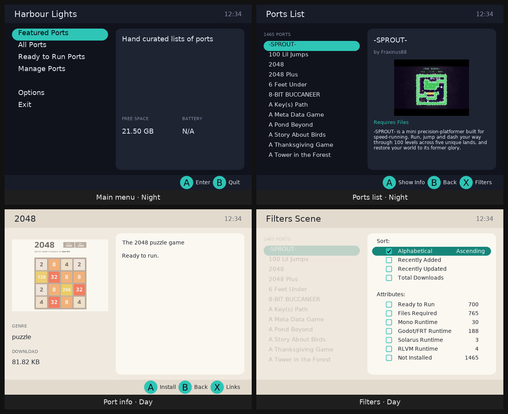

You don't need to know how to program. A theme is one text file, `theme.json`, plus any images and fonts you want. Everything it can do is in the [theme reference, THEME.md](https://github.com/PortsMaster/PortMaster-GUI/blob/main/THEME.md); this guide shows you the parts you need, in the order you need them.

## Contents

1. [What you need](#what-you-need)
2. [Step 1: the seven screens](#step-1-the-seven-screens)
3. [Step 2: colors, a header and a footer](#step-2-colors-a-header-and-a-footer)
4. [Step 3: two panes](#step-3-two-panes)
5. [Step 4: styles, and the other screens](#step-4-styles-and-the-other-screens)
6. [Step 5: a day and a night](#step-5-a-day-and-a-night)
7. [Step 6: images](#step-6-images)
8. [Step 7: every screen size, every language](#step-7-every-screen-size-every-language)
9. [Trying it on your device](#trying-it-on-your-device)
10. [Sharing it](#sharing-it)
11. [When something's wrong](#when-somethings-wrong)
12. [The themes so far](#the-themes-so-far)

## What you need

**A way to see your theme.** PortMaster's **theme server** draws every PortMaster screen with your theme, and redraws when you save. There are two ways to run it:

- **On your device, nothing to install:** in PortMaster, **Options › Theme Editor**. It shows an address and a QR code; open it on a computer or phone on the same network.
- **On a computer** (Linux or macOS), from a copy of PortMaster's code:

  ```bash
  git clone https://github.com/PortsMaster/PortMaster-GUI
  cd PortMaster-GUI
  python3 -m venv .venv && .venv/bin/pip install -r requirements-dev.txt
  .venv/bin/python tools/theme_server/serve.py --themes ~/my-themes
  ```

  then open http://localhost:8090/. `~/my-themes` is a folder with your theme folders in it.

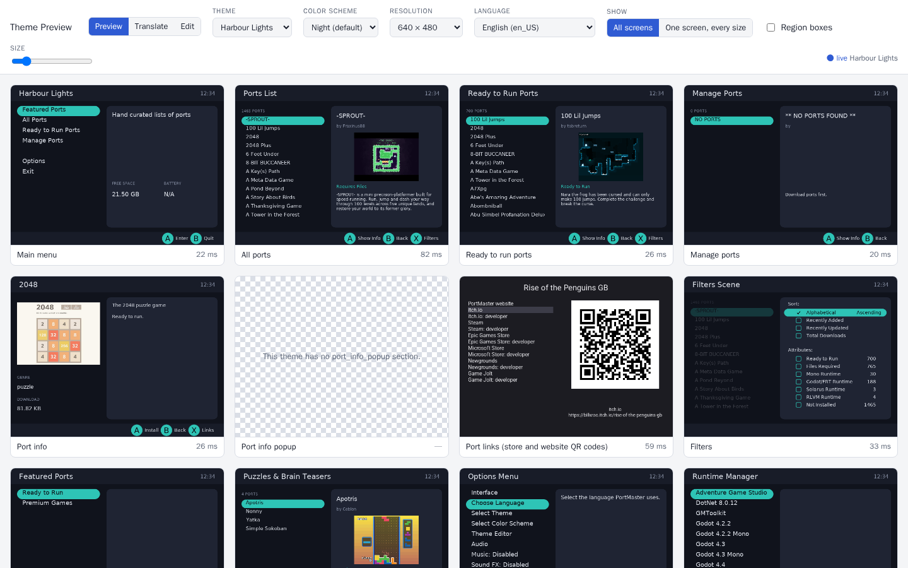

**A text editor.** The theme server has one: pick **Edit** at the top. It suggests keys and values as you type, points out mistakes, and redraws the screen beside it as you go. Any other text editor is fine too; the theme server redraws when you save.

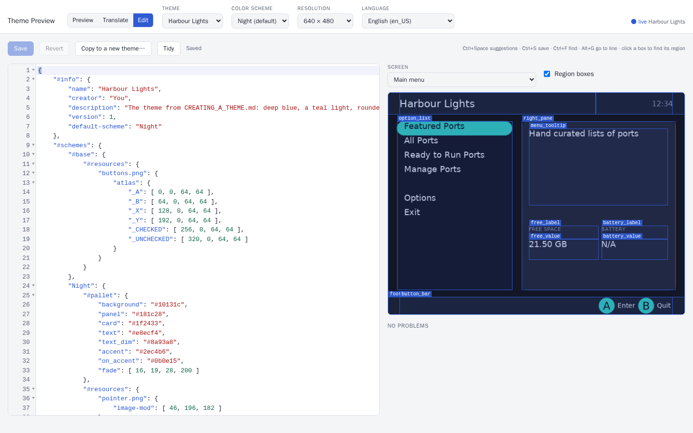

**A theme folder.** Make a folder for your theme in your themes folder: `~/my-themes/harbour_lights/`. Its name is how PortMaster knows the theme: lower case, no spaces. Everything you make goes in it.

## Step 1: the seven screens

PortMaster needs a theme to draw seven screens. Put this in `harbour_lights/theme.json`:

```json
{
    "#info": {
        "name": "Harbour Lights",
        "creator": "You"
    },
    "#base": {
        "font": "DejaVuSans.ttf",
        "font-size": 16,
        "font-color": [ 232, 236, 244 ]
    },
    "main_menu":      { "option_list": { "area": [ 0.1, 0.1, 0.9, 0.9 ] } },
    "option_menu":    { "option_list": { "area": [ 0.1, 0.1, 0.9, 0.9 ] } },
    "ports_list":     { "ports_list":  { "area": [ 0.1, 0.1, 0.9, 0.9 ] } },
    "port_info":      { "port_desc":   { "area": [ 0.1, 0.1, 0.9, 0.9 ], "text": "{port_info.description}", "text-wrap": true } },
    "filter_list":    { "filter_list": { "area": [ 0.1, 0.1, 0.9, 0.9 ] } },
    "message_window": { "message_text": { "area": [ 0.1, 0.1, 0.9, 0.9 ], "text": "" } },
    "message_box":    { "message_text": { "area": [ 0.1, 0.1, 0.9, 0.9 ], "text": "", "text-wrap": true } }
}
```

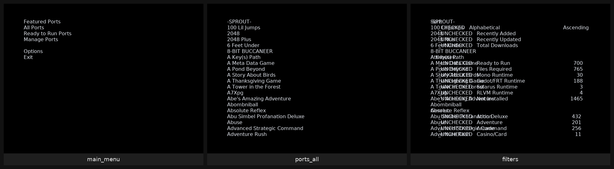

It's plain, but it's a theme. What's in it:

- **`#info`** names the theme and says who made it. Both are needed to share it.
- **`#base`** holds keys every region starts from: here, the font, its size and its color. `DejaVuSans.ttf` comes with PortMaster, so the theme doesn't need a copy.
- **The sections** are the screens: `main_menu`, `ports_list` and so on. In each one is a **region**, a rectangle PortMaster draws. Each screen needs a region with a particular name (`option_list`, `ports_list` …) for its list: [the screens](https://github.com/PortsMaster/PortMaster-GUI/blob/main/THEME.md#the-screens) lists them.
- **`area`** is where a region goes: `[ left, top, right, bottom ]`, as fractions of the screen. `[ 0.1, 0.1, 0.9, 0.9 ]` leaves a tenth of the screen all round. Write the decimal point: `1.0` is the whole width, but `1` is one pixel.
- **`{port_info.description}`** is a **tag**: PortMaster puts the selected port's description there, and keeps it up to date.

Look at the filters: they're drawn over the ports list, and say `_UNCHECKED` where the checkboxes should be. Both get fixed below.

## Step 2: colors, a header and a footer

[`docs/tutorial/step-2`](docs/tutorial/step-2/theme.json)

Name the theme's colors in **`#pallet`**, then use the names everywhere. Colors are `"#rrggbb"`, or `[ red, green, blue ]` from 0 to 255:

```json
    "#pallet": {
        "background": "#10131c",
        "panel":      "#181c28",
        "card":       "#1f2433",
        "text":       "#e8ecf4",
        "text_dim":   "#8a93a8",
        "accent":     "#2ec4b6",
        "on_accent":  "#0b0e15"
    },
    "#base": {
        "font": "DejaVuSans.ttf",
        "font-size": 16,
        "font-color": "text"
    },
```

Every screen gets the same background, header and footer, so make them **elements**: regions defined once in `#elements`, which every screen can use.

```json
    "#elements": {
        "background": { "area": [ 0.0, 0.0, 1.0, 1.0 ], "fill": "background" },
        "header":     { "area": [ 0.0, 0.0, 1.0, 0.1 ], "fill": "panel" },
        "title":      { "parent": "header", "area": [ 0.04, 0.0, 0.7, 1.0 ], "font-size": 22,
                        "align": "midleft", "text": "{scene.title}" },
        "clock":      { "parent": "header", "area": [ 0.7, 0.0, 0.96, 1.0 ], "font-color": "text_dim",
                        "align": "midright", "text": "{system.time_24hr}" },
        "footer":     { "area": [ 0.0, 0.92, 1.0, 1.0 ], "fill": "panel" },
        "button_bar": { "parent": "footer", "area": [ 0.04, 0.0, 0.96, 1.0 ], "font-size": 14,
                        "align": "midright", "bar": [] }
    },
```

- **`parent`** puts a region inside another: `title`'s area is a part of `header`, not of the whole screen. Move the header, and everything in it moves too.
- **`{scene.title}`** is each screen's title ("Ports List"), **`{system.time_24hr}`** the time.
- **`button_bar`** is a name PortMaster looks for: it fills its `bar` with the buttons each screen offers.

Each screen then uses them with `"#element:<name>"`, and adds its own list:

```json
    "main_menu": {
        "#element:background": {},
        "#element:header": {},
        "#element:title": { "text": "Harbour Lights" },
        "#element:clock": {},
        "option_list": {
            "area": [ 0.04, 0.13, 0.96, 0.89 ],
            "font-size": 18,
            "line-height": 1.5,
            "select-fill": "accent",
            "select-color": "on_accent"
        },
        "#element:footer": {},
        "#element:button_bar": {}
    },
```

Regions are drawn in order, so the background comes first. `"#element:title": { "text": "Harbour Lights" }` is the title element with its text changed for this screen only. `select-fill` and `select-color` draw the selected row.

The buttons and checkboxes are **special words** (`_A`, `_B`, `_CHECKED` …). `#override` gives them text until step 6 gives them images:

```json
    "#override": { "_A": "(A)", "_B": "(B)", "_X": "(X)", "_Y": "(Y)", "_CHECKED": "[x]", "_UNCHECKED": "[ ]" },
```

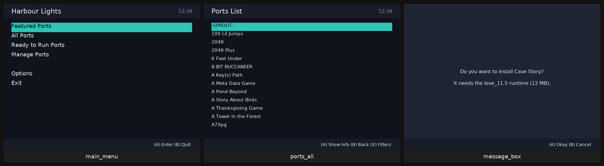

## Step 3: two panes

[`docs/tutorial/step-3`](docs/tutorial/step-3/theme.json)

Split the screen into a list on the left and a card on the right. Two more elements are the panes, and everything else sits in one of them:

```json
        "left_pane":  { "area": [ 0.03, 0.13, 0.42, 0.89 ] },
        "right_pane": { "area": [ 0.45, 0.13, 0.97, 0.89 ], "fill": "card", "roundness": 12 },
        "menu": {
            "parent": "left_pane",
            "area": [ 0.0, 0.0, 1.0, 1.0 ],
            "font-size": 18,
            "line-height": 1.5,
            "select-fill": "accent",
            "select-color": "on_accent",
            "autoscroll": "marquee"
        },
```

`roundness` rounds the card's corners. `menu` is the look of every list, and each screen gives it its own name: `"#element:menu:option_list"` is the `menu` element drawn as a region called `option_list`.

The ports list shows the selected port in the card, with tags:

```json
    "ports_list": {
        …
        "port_count": { "parent": "left_pane", "area": [ 0.0, 0.0, 1.0, 0.08 ], "font-size": 11,
                        "font-color": "text_dim", "text": "{ports_list.filter_ports} PORTS" },
        "#element:menu:ports_list": { "area": [ 0.0, 0.09, 1.0, 1.0 ], "font-size": 15 },
        "#element:right_pane": {},
        "port_title":  { "parent": "right_pane", "area": [ 16, 12, -16, 0.13 ], "font-size": 18, "text": "{port_info.title}" },
        "port_porter": { "parent": "right_pane", "area": [ 16, 0.13, -16, 0.2 ], "font-size": 12, "text": "by {port_info.porter}" },
        "port_image":  { "parent": "right_pane", "area": [ 16, 0.22, -16, 0.62 ], "image": "{port_info.image}" },
        "port_status": { "parent": "right_pane", "area": [ 16, 0.63, -16, 0.7 ], "font-color": "accent", "text": "{port_info.ready_to_run}" },
        "port_desc":   { "parent": "right_pane", "area": [ 16, 0.71, -16, -12 ], "font-size": 12, "text-wrap": true,
                         "text": "{port_info.description}" },
        …
    },
```

The areas mix fractions and pixels: `[ 16, 0.22, -16, 0.62 ]` is 16 pixels in from the card's left and right edges (a negative number counts from the right or bottom), and from 22% to 62% of the way down it. `"image": "{port_info.image}"` is the port's screenshot.

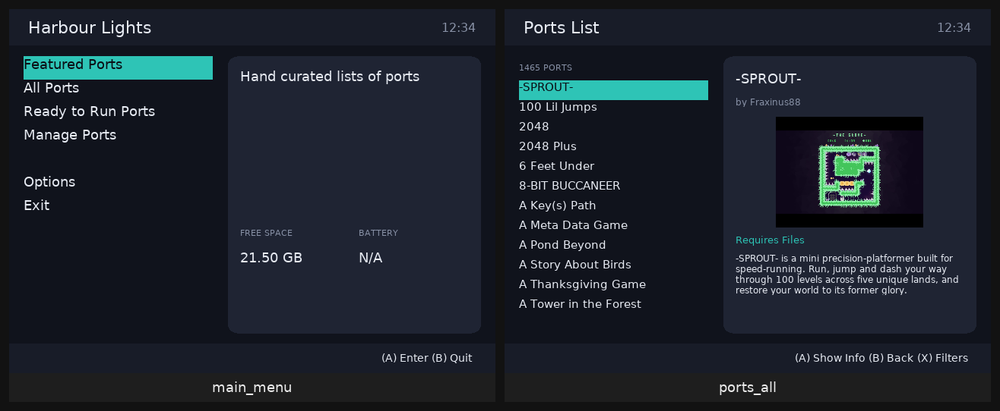

In the theme server, **Region boxes** draws each region's area and name. Here they are, numbered:

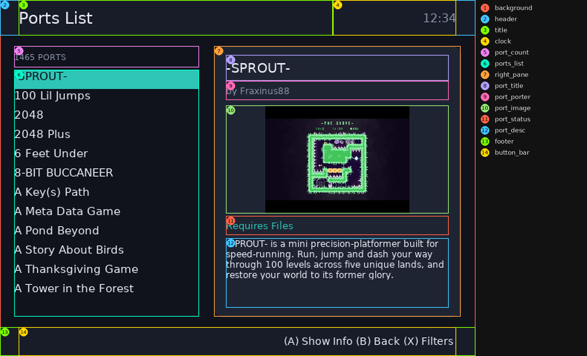

## Step 4: styles, and the other screens

[`docs/tutorial/step-4`](docs/tutorial/step-4/theme.json)

Small grey labels, big headings, wrapped body text: the same few looks come up again and again. Name them in **`#styles`**, and give a region a `style` to start from:

```json
    "#styles": {
        "heading": { "font-size": 22 },
        "label":   { "font-size": 11, "font-color": "text_dim" },
        "body":    { "font-size": 14, "text-wrap": true, "autoscroll": "slide", "scroll-delay-start": 3000 }
    },
```

```json
        "genre_label": { "parent": "left_pane", "area": [ 0.0, 0.64, 1.0, 0.71 ], "style": "label", "text": "GENRE" },
        "genre":       { "parent": "left_pane", "area": [ 0.0, 0.71, 1.0, 0.8 ], "text": "{port_info.genres}" },
```

A region's own keys win over its style, so `"style": "label", "font-size": 12` is a slightly bigger label. Change `label` once, and every label changes.

Then the rest of the screens. The port info screen, the downloads screen with its progress bar (a region called `progress_bar`, filled with `progress-fill` as a download goes), and the filters:

```json
    "filter_list": {
        "#element:background": { "fill": "fade", "blend-mode": "blend" },
        …
        "#element:right_pane": {},
        "#element:menu:filter_list": { "parent": "right_pane", "area": [ 12, 12, -12, -12 ], "font-size": 14, "line-height": 1.4 },
        …
    },
```

The filters screen is drawn on top of the ports list screen. Its background is `fade`, the background color but see-through (`"fade": [ 16, 19, 28, 200 ]`: the fourth number is how solid it is, out of 255), so the ports list shows dimly behind it. A see-through color needs `"blend-mode": "blend"`, or it's drawn solid.

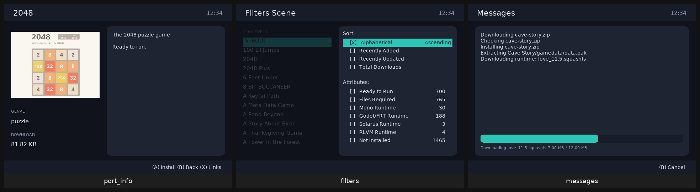

## Step 5: a day and a night

[`docs/tutorial/step-5`](docs/tutorial/step-5/theme.json)

Because every color has a name, a second set of colors is a second `#pallet`. Color schemes go in **`#schemes`**, and the player picks one in **Options › Select Color Scheme**:

```json
    "#info": { …, "default-scheme": "Night" },
    "#schemes": {
        "Night": {
            "#pallet": { "background": "#10131c", "panel": "#181c28", "card": "#1f2433", "text": "#e8ecf4",
                         "text_dim": "#8a93a8", "accent": "#2ec4b6", "on_accent": "#0b0e15", "fade": [ 16, 19, 28, 200 ] }
        },
        "Day": {
            "#pallet": { "background": "#efe9df", "panel": "#e2dacd", "card": "#fbf8f2", "text": "#22262e",
                         "text_dim": "#6b6f78", "accent": "#16857a", "on_accent": "#ffffff", "fade": [ 239, 233, 223, 200 ] }
        }
    },
```

The theme's own `#pallet` goes: each scheme brings its own.

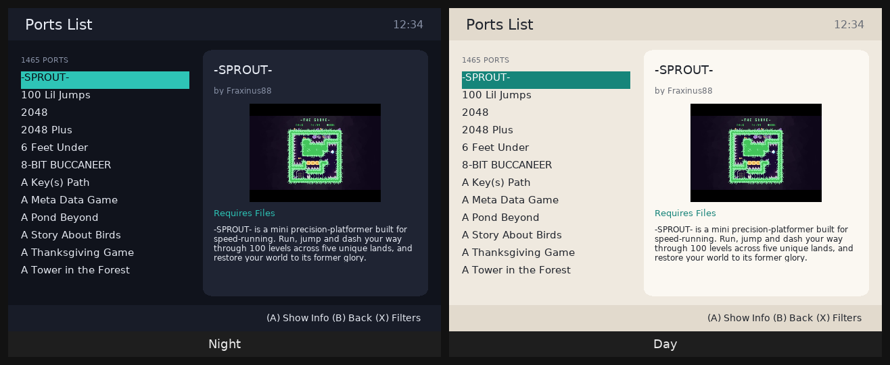

## Step 6: images

[`docs/tutorial/step-6`](docs/tutorial/step-6/) (with its `buttons.png` and `pointer.png`)

Images go in the theme folder. Images used everywhere are listed in **`#resources`**, loaded once with the theme. One image can hold many pictures, an **atlas**: here the buttons and checkboxes, in one row of 64x64 squares, named as the special words they stand for:


```json
    "#resources": {
        "buttons.png": {
            "atlas": {
                "_A": [ 0, 0, 64, 64 ],   "_B": [ 64, 0, 64, 64 ],
                "_X": [ 128, 0, 64, 64 ], "_Y": [ 192, 0, 64, 64 ],
                "_CHECKED": [ 256, 0, 64, 64 ], "_UNCHECKED": [ 320, 0, 64, 64 ]
            }
        }
    }
```

Each piece is `[ x, y, width, height ]` in the image. With images for them, the `#override` text isn't needed any more.

The selected row gets a **pointer**: a half circle at each end, so it looks like a pill. `pointer.png` is one white half circle, and each scheme tints it its own accent color with `image-mod`. So `#resources` moves into `#schemes`: `#schemes`' own `#base` is what every scheme starts from.

```json
    "#schemes": {
        "#base": { "#resources": { "buttons.png": { "atlas": { … } } } },
        "Night": { "#pallet": { … }, "#resources": { "pointer.png": { "image-mod": [ 46, 196, 182 ] } } },
        "Day":   { "#pallet": { … }, "#resources": { "pointer.png": { "image-mod": [ 22, 133, 122 ] } } }
    },
```

```json
        "menu": {
            …
            "pointer": "pointer.png",
            "pointer-fit": "row",
            "pointer-attach": "list",
            "pointer-align": [ "midleft", "midright" ],
            "pointer-mirror": true
        },
```

`pointer-fit: row` makes the pointer exactly as tall as a row, whatever the font size; `pointer-attach: list` puts it at the ends of the row; `pointer-mirror` adds the flipped one at the other end.

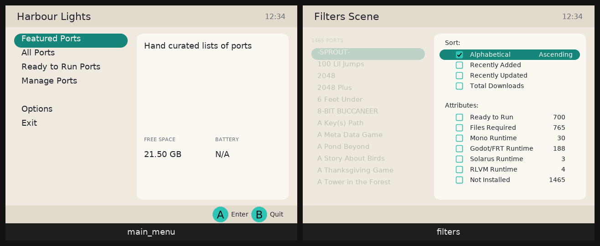

## Step 7: every screen size, every language

[`docs/tutorial/step-7`](docs/tutorial/step-7/): the finished theme.

PortMaster runs on handhelds with screens from 480x320 to 1920x1152, wide, square and tall. So far the theme's text is sized for 640x480. One line in `#base` makes it follow the screen:

```json
        "font-scale": "auto",
```

`"auto"` scales every font size by how much bigger the screen is than 640x480 (1.5 at 1280x720), and never below three quarters, so small screens stay readable.

Because every region sits in a pane, and every pane is in fractions of the screen, the layout stretches to fit any screen. Except one: on a square screen the two panes are too narrow side by side. A key with a **capability** in square brackets counts only on screens that have it, so the panes stack on square screens:

```json
        "left_pane":  { "area": [ 0.03, 0.13, 0.42, 0.89 ], "area[square]": [ 0.03, 0.13, 0.97, 0.47 ] },
        "right_pane": { "area": [ 0.45, 0.13, 0.97, 0.89 ], "area[square]": [ 0.03, 0.5, 0.97, 0.89 ], … },
```

Only the panes change; everything in them follows. Other capabilities are the screen's size (`[1280x720]`), its shape (`[16:9]`, `[wide]`, `[hires]`), the language and more: [capabilities](https://github.com/PortsMaster/PortMaster-GUI/blob/main/THEME.md#capabilities-keys-for-some-devices).

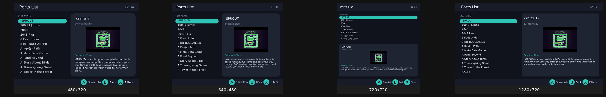

**Languages.** PortMaster is translated into many languages. DejaVu Sans has no Chinese, Japanese or Korean, but PortMaster carries Noto Sans for each. `font-override` gives every region that font in that language:

```json
        "font-override[ja_JP]": "NotoSansJP-Regular.ttf",
        "font-override[ko_KR]": "NotoSansKR-Regular.ttf",
        "font-override[zh_CN]": "NotoSansSC-Regular.ttf",
        "font-override[zh_TW]": "NotoSansTC-Regular.ttf",
        "font-override[zh_HK]": "NotoSansHK-Regular.ttf"
```

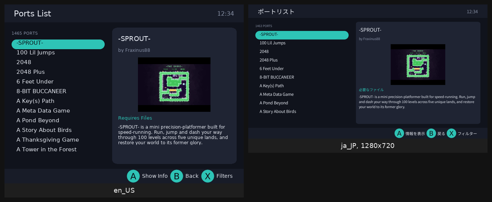

The text a theme writes itself ("FREE SPACE", "GENRE") is translated too, once the theme is in the theme list: see [translations](https://github.com/PortsMaster/PortMaster-GUI/blob/main/THEME.md#translations).

**Check it.** In the theme server, **One screen, every size** shows a screen at every common size (and **Layout**, at the top, each of a theme's [layouts](https://github.com/PortsMaster/PortMaster-GUI/blob/main/THEME.md#layouts-a-list-or-a-grid), when it has more than one). And from a PortMaster-GUI checkout, this draws every screen at the sizes you give and lists anything overlapping, cut off or off the screen:

```bash
.venv/bin/python tools/theme_server/serve.py --themes ~/my-themes --export /tmp/out \
    --theme harbour_lights --resolutions 480x320,640x480,720x720,1280x720,720x1280 --schemes all --layouts all --check
```

Harbour Lights passes at all of them.

## Trying it on your device

1. Copy the theme folder into the `themes` folder in your device's PortMaster folder (the `PortMaster` folder next to your ports: `roms/ports/PortMaster/themes/harbour_lights/` on most systems).
2. In PortMaster, **Options › Select Theme**, and pick it.

Or skip copying: **Options › Theme Editor** on the device, then **Edit**, **Copy to a new theme…** in the page, and edit it there. It saves on the device, and PortMaster's theme list has it straight away.

## Sharing it

Themes in PortMaster's theme list come from this repository. To add yours:

1. **A screenshot.** `screenshot.png` in the theme folder is its picture in the theme list: save one from the theme server (**Save PNG**, 640x480, the main menu or the ports list).
2. **Credits and licenses.** Every font in the folder needs a license that lets PortMaster share it (free for non-commercial use is fine). List each in a `CREDITS.md` with its author and license, and put the license file next to it:

   ```markdown
   | File | Font | Author | License |
   |---|---|---|---|
   | `Inter-Medium.otf` | Inter Medium | Rasmus Andersson | SIL Open Font License 1.1 ([LICENSE.inter.txt](LICENSE.inter.txt)) |
   ```

   Do the same for images you didn't make. Fonts PortMaster carries (DejaVu Sans, Noto Sans CJK) don't need a copy or a credit.
3. **Check it** in a copy of this repository: put your folder in `themes/`, then

   ```bash
   python3 tools/build_themes.py --check-only
   ```

4. **Open a pull request** with your folder. The pull request runs the same check, and the layout check at several screen sizes.

Once it's merged, it's in everyone's theme list.

## When something's wrong

| What you see | Why, and what to do |
|---|---|
| The theme isn't in the list | `theme.json` doesn't parse, or it's not in its own folder in `themes`. Open it in the theme server's editor: it points to the mistake. |
| PortMaster quits when you open a screen | One of the seven screens is missing, or a region it needs isn't there: the theme server says which, on that screen. |
| `_A` or `_UNCHECKED` in the button bar or the filters | Those special words have neither an image nor `#override` text. |
| A see-through color is solid | It needs `"blend-mode": "blend"`. |
| Text is tiny on a big screen | `"font-scale": "auto"` in `#base`. |
| Text is cut off | Its area is too small for it: make it bigger, or let it scroll with `"autoscroll": "slide"`. |
| Something's in the wrong place on one screen size | Use a capability key for that size (`"area[16:9]"`), on the pane rather than on each region. |
| A key does nothing | Its name is wrong, or it's a key the region doesn't have: the editor flags both, with "did you mean". |
| Colors look wrong in one scheme | A color in `#pallet` that isn't in that scheme's `#pallet`. |

The [theme reference](https://github.com/PortsMaster/PortMaster-GUI/blob/main/THEME.md) has the rest: every key, every tag, every screen.

## The themes so far

Every theme in this repository, on the ports list. Their folders are in [`themes/`](themes/): open them, borrow ideas.

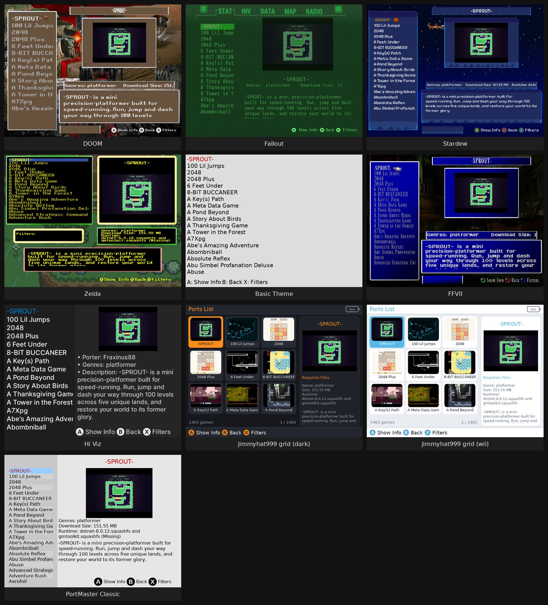

---

The tutorial's files (`docs/tutorial/`: its `theme.json` files, `buttons.png` and `pointer.png`) are yours to copy into your own themes, with no conditions: [CC0 1.0](https://creativecommons.org/publicdomain/zero/1.0/).
